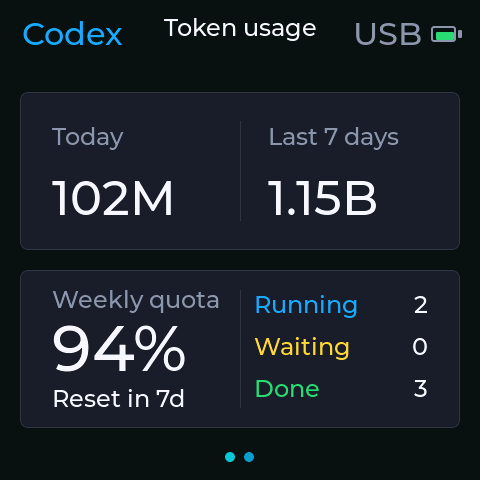
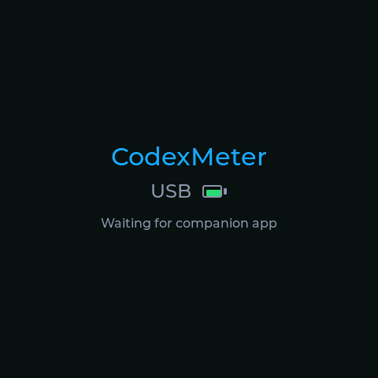

# CodexMeter — Windows & ESP32-C6

An English Windows companion and Waveshare ESP32-C6 port of
[tomatoeggs/CodexMeter](https://github.com/tomatoeggs/CodexMeter).
Keep your Codex quota, local token activity and chat status on a small AMOLED
screen beside your computer.

This fork adds a standalone Windows tray app, support for the
**Waveshare ESP32-C6-Touch-AMOLED-2.16(-EN)**, and a **Classic Tasks** dashboard.
It retains the original project's history, license and themes.
Our maintained branch is **`windows-c6`**.

**[Windows setup and flashing](README.windows.md)** ·
**[Implementation notes](docs/windows-port.md)** ·
**[Original upstream README (Chinese)](README.upstream.md)**

## On the display

These are actual 480 × 480 screenshots captured from the C6, not mockups.
The numbers are examples from the capture, not live values.

<table>
  <tr>
    <th>Classic Tasks</th>
    <th>Waiting for the companion</th>
  </tr>
  <tr>
    <td></td>
    <td></td>
  </tr>
</table>

### Classic Tasks

An additional variant of the original Classic theme places chat counts in the
lower-right quarter and the quota reset countdown below the remaining
percentage. Spacing and reset text were adjusted for readability on the C6.
The original Classic theme remains available.

- **Running:** active chats that are not waiting for input or approval.
- **Waiting:** chats awaiting your input or approval.
- **Done:** chats whose latest turn completed but remains unread.

The Windows companion observes local Codex desktop chat metadata; reading these
counts does not mark chats read or take control of them. Missing or stale chat
telemetry shows `--` rather than an invented zero.

### Powered-on waiting screen

Before companion data arrives, the screen shows three centered lines:
**CodexMeter**, the actual USB/battery status, and **Waiting for companion app**.
It returns to the selected theme when valid companion data arrives.

The waiting screen also appears after Bluetooth disconnects, or after five
minutes without host payloads on an otherwise connected link. These conditions
no longer automatically blank the screen. Manual screen-off and the companion's
Windows lock policy still apply. The existing small OLED pixel shifts also
apply to the waiting screen.

## What changed from upstream?

This comparison describes the upstream version this port started from
([`fd6500a`](https://github.com/tomatoeggs/CodexMeter/commit/fd6500a)), rather than
claiming to track every subsequent upstream change.

| Area | Windows/C6 changes in this fork |
| --- | --- |
| Desktop app | Windows control panel and system tray, connection status, open/hide controls and clean quit. |
| Distribution | Nuitka single-executable packaging; the packaged app needs no separate Python installation or installer. |
| Startup | Optional startup at Windows login. Automatic discovery of Codex's versioned executable avoids editing its path after each update. |
| Windows integration | Windows process locking, authenticated local IPC, hidden child processes, lock/unlock handling and serial tooling. |
| C6 hardware | Board-specific pins, panel initialization, power handling and corrected automatic rotation in all four orientations. |
| Themes | All 11 original themes adapted to the C6's limited RAM, plus the new Classic Tasks variant. |
| Language | English runtime UI, alerts, settings and setup documentation. Historical upstream documents are preserved. |
| Task counts | Live Running, Waiting and Done counts from local Codex desktop state. |
| Power indicator | Shows USB when USB power is present and no battery is connected; a connected battery uses its percentage. |
| Host unavailable | A visible waiting screen replaces automatic blanking on host loss. |
| Bluetooth recovery | Detects sustained empty discovery scans and attempts bounded Windows radio recovery with cooldowns; respects manually disabled Bluetooth. |
| Diagnostics | Local lifecycle records, bridge/UI heartbeats and exception/native-fault traces, without automatically restarting the app. |
| Development | Windows/macOS Python test workflow, C6 font/artwork build tooling, tiled screen capture and hardware validation tools. |

Quota collection, local token counting, the BLE protocol and the original theme
artwork build on the upstream project. The C6 adaptations use flash-mapped
artwork, static fonts and small drawing buffers because this board has no PSRAM.

The 12 available themes are **Classic, Classic Tasks, Cyberpunk, Famicom,
Animal Crossing, Gundam, Gargantua, NIXIE RACK, Three Body, WALL-E,
WALL-E EARTH and WALL-E BLUEPRINT**.

## Getting started

You need Windows 10/11 with Bluetooth LE, Codex installed and signed in, the
supported Waveshare C6 board, and a USB-C data cable for flashing. Runtime data
travels over Bluetooth; USB can supply power. No separate API key is required,
and Codex credentials are not copied to the display.

1. Follow the [Windows setup guide](README.windows.md) to build the companion
   and the `waveshare_c6_amoled_216` firmware target.
2. Flash the C6 using the board-specific instructions. The original S3 flashing
   instructions are not suitable for this board.
3. Open the control panel, check usage, register the display and start the bridge.
4. Select **Classic Tasks** in the display settings if you want the chat counts.
   Enable login startup if desired.

The source checkout does **not** include `CodexMeter.exe`, firmware build outputs
or runtime logs. After building, the standalone app is published locally to
`dist/windows/CodexMeter.exe`. Build and install details are in
[README.windows.md](README.windows.md); do not assume an upstream release binary
contains this fork's changes.

The supplied Windows scripts use **D:** for active build output, dependencies
and caches, with retained bundles on **E:** in the development setup. Review the
[location configuration](README.windows.md#locations) before building on another
machine; the scripts do not silently fall back to another build drive.

## Scope and limitations

- Local token totals are activity from this computer's session logs, including
  cached input. They are not subscription quota usage and do not cover other
  computers or cloud-only chats. Quota percentages come from Codex separately.
- Chat counts depend on a private, versioned Codex desktop interface. A future
  Codex update may require adapting that observer even though executable path
  discovery remains automatic.
- The C6's static fonts cover the English/Latin UI, not arbitrary Unicode text.
  Touch input and audio are not implemented by this port.
- The macOS and S3 code paths are retained. The physical hardware used for this
  port's validation is the C6; see the [validation notes](docs/windows-port.md#verification)
  for what was checked and what remains outside that coverage.
- Diagnostics stay local and do not upload reports. They help investigate
  failures; there is no automatic app-restart watchdog. Some ordinary companion
  logs can contain task summaries, so review them before sharing.

## Upstream and license

The original README is preserved verbatim in [README.upstream.md](README.upstream.md)
from the upstream commit on which this port was based. It documents the original
macOS/S3 setup and includes the original project images and links.

Thanks to [tomatoeggs/CodexMeter](https://github.com/tomatoeggs/CodexMeter) for the
original application, firmware and themes. The original copyright and
[MIT license](LICENSE) are retained. See [NOTICE.md](NOTICE.md) for third-party
attribution.
