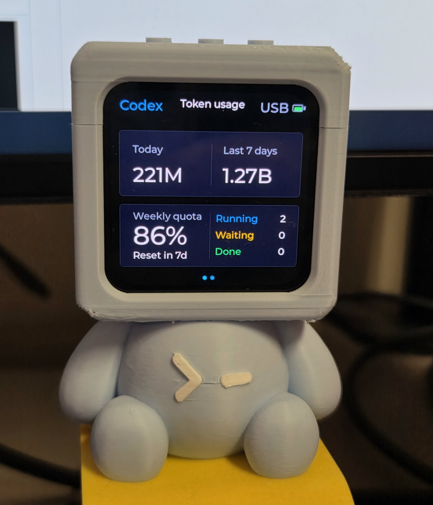
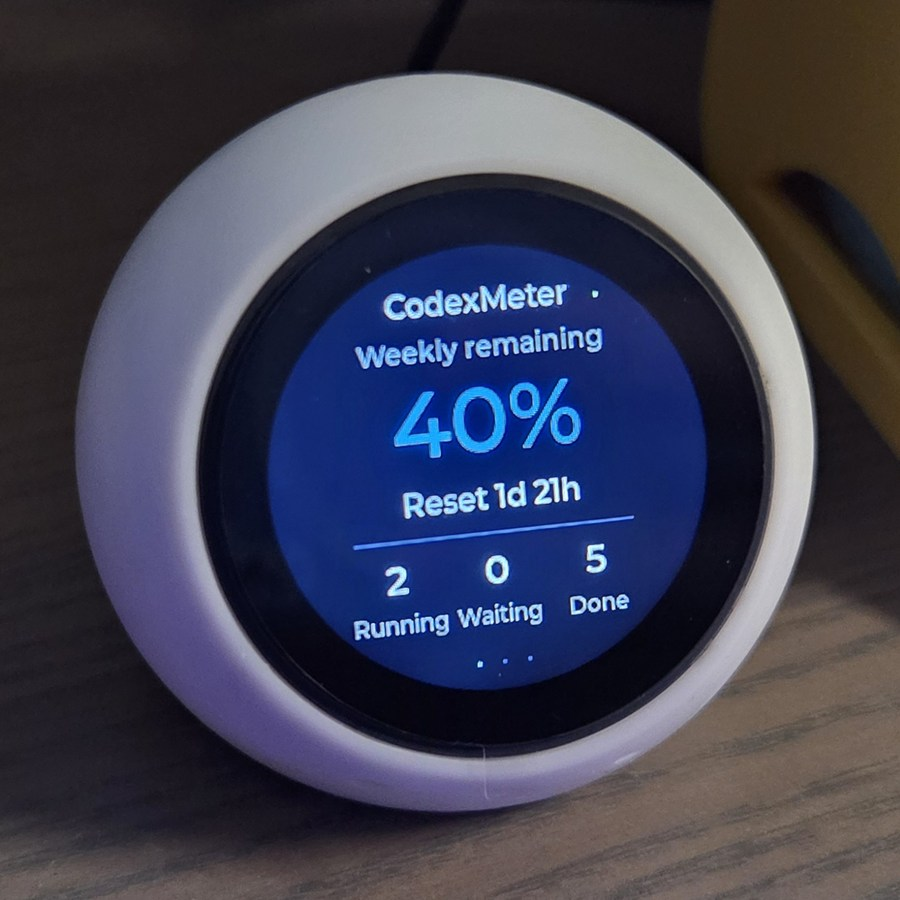
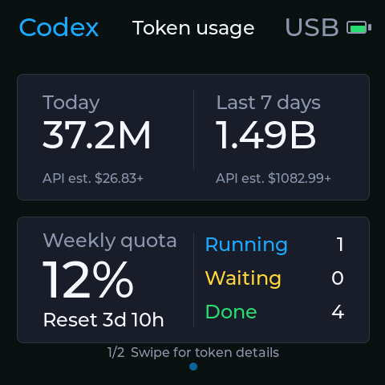
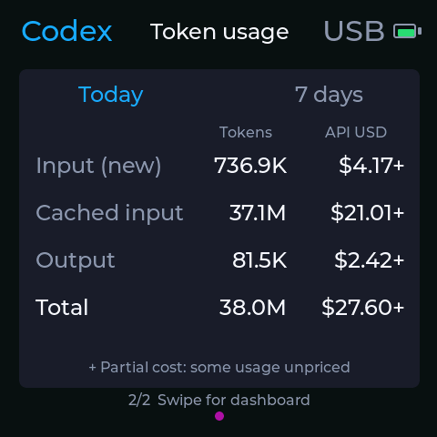
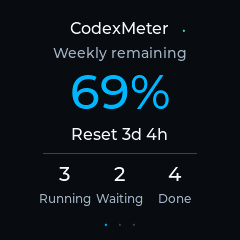
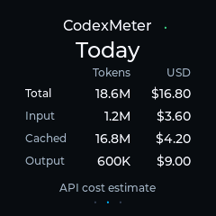
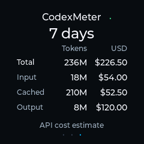
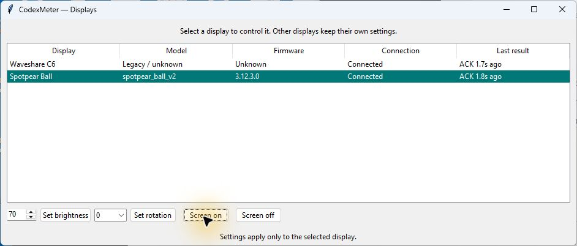
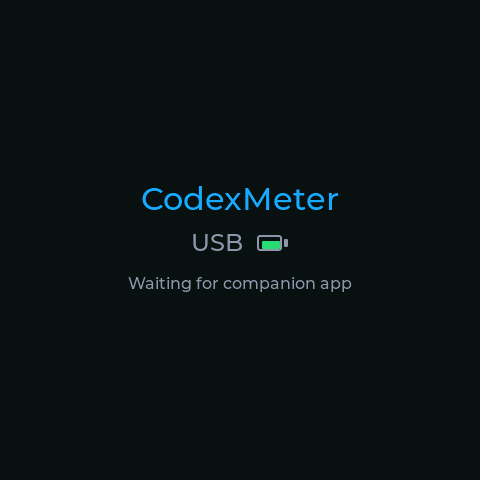

# CodexMeter Companion

Keep your Codex quota, token usage and chat status on a small display beside your
computer. The Windows companion runs in the system tray and sends updates over
Bluetooth to a **Waveshare C6**, a **Spotpear Ball**, or both.

<table>
  <tr><th>Waveshare C6</th><th>Spotpear Ball</th></tr>
  <tr>
    <td align="center"></td>
    <td align="center"></td>
  </tr>
  <tr><td colspan="2">Both displays running CodexMeter. The printed-case photo shows an earlier dashboard; current screens are shown below.</td></tr>
</table>

**[Download the latest release](https://github.com/roel-v/CodexMeter-Companion/releases/latest)** ·
[Setup](README.windows.md) · [Ball guide](docs/spotpear-ball.md) · [Changelog](CHANGELOG.txt)

This is an English Windows fork of
[tomatoeggs/CodexMeter](https://github.com/tomatoeggs/CodexMeter), with firmware
for the two displays shown here. The companion is a single executable: no
installer or separate Python installation is needed.

## Get started

You need Windows 10/11 with Bluetooth LE, Codex installed and signed in, a
supported display, and a USB data cable to flash its firmware.

1. Download **CodexMeter.exe** and the firmware for your display from the
   [latest release](https://github.com/roel-v/CodexMeter-Companion/releases/latest).
2. Follow the [Waveshare C6 setup](README.windows.md) or
   [Spotpear Ball setup](docs/spotpear-ball.md#build-and-flash) to flash the board.
3. Run the companion, register your display in the control panel and start the
   bridge. You can register both displays in the same app.
4. Enable startup at login if you want it to run whenever you sign in.

| Display | Firmware download | Screen |
| --- | --- | --- |
| Waveshare **ESP32-C6-Touch-AMOLED-2.16(-EN)** | `waveshare-c6-amoled-216-factory.bin` | 480 × 480 AMOLED |
| Spotpear **ESP32-S3 1.28-inch Ball/BOX V2** | `spotpear-ball-v2-factory.bin` | 240 × 240 round LCD |

Use the image for your exact board; these firmwares are not interchangeable.
The release includes flashing instructions and SHA-256 checksums. USB supplies
power; usage updates travel over Bluetooth. No separate API key is needed, and
Codex credentials stay on the computer.

## What you can see

The **Classic Tasks** dashboard shows your weekly quota remaining, when it resets,
and three chat counts:

- **Running:** chats currently working.
- **Waiting:** chats that need your input or approval.
- **Done:** chats with a completed turn you haven't read yet.

Token details show today's usage and the last seven days, split into uncached
input, cached input and output, with estimated costs at Standard API rates.
Both displays show completion notifications and return to your selected page
afterward. Pages stay where you leave them until you swipe again.

### Waveshare C6

The C6 has a dashboard and a token-details page. Swipe horizontally between them;
on the details page, tap **Today** or **7 days** to choose the period.
Select **Classic Tasks** in the display's theme settings for this layout.

<table>
  <tr><th>Dashboard</th><th>Token details</th></tr>
  <tr>
    <td></td>
    <td></td>
  </tr>
  <tr><td colspan="2">Captured from the C6 display. Values are examples from the capture.</td></tr>
</table>

The C6 supports automatic rotation and shows USB or battery status. It also
includes the original themes: Classic, Cyberpunk, Famicom, Animal Crossing,
Gundam, Gargantua, NIXIE RACK, Three Body, WALL-E, WALL-E EARTH and WALL-E BLUEPRINT.

### Spotpear Ball

The Ball uses the same information across three pages: quota and chats, Today,
and 7 days. Swipe left or right, or briefly press BOOT, to move through them.
Swiping past the last page takes you back to the first.

<table>
  <tr><th>Quota and chats</th><th>Today</th><th>7 days</th></tr>
  <tr>
    <td></td>
    <td></td>
    <td></td>
  </tr>
  <tr><td colspan="3">Captured from the Ball display using test values.</td></tr>
</table>

The Ball has one layout. Brightness and rotation can be set from the companion.
Automatic rotation, battery/USB indicators and audio are not supported on this
board. See the [Ball guide](docs/spotpear-ball.md) for controls and hardware details.

## The Windows companion

Open the tray icon to check the connection or change settings. Closing the
control panel leaves the companion running; choose **Quit CodexMeter** from
the tray menu to stop it. Codex's executable is found automatically, including
after Codex updates.

For multiple displays, open **Displays** to check each connection and control
supported settings separately. They share the same usage and chat data while
keeping their own page and settings.

When the companion hasn't connected yet, or the connection is lost, both displays
show **Waiting for companion app**. They return to your selected page when data
arrives. Manually turning a screen off keeps it off; the Windows lock policy
also still applies.

   
  The waiting screen on the C6. The Ball shows the message without a power indicator.

### Usage and cost estimates

Quota comes from Codex. Token totals come from this computer's local session
logs, so they won't include work done on other computers or cloud-only chats.
Unknown or stale chat counts show `--`.

The dollar amounts estimate what the recorded tokens would cost at Standard API
rates; they are not your subscription bill. A **+** means some usage couldn't be
priced. Open **Tokens / pricing** for the model breakdown and saved pricing history.

The app checks the OpenAI pricing page daily. If it changes, **Review pricing
change** opens an explanation and comparison with the saved rates. A page edit
can trigger this even when prices stay the same. Accepting reviewed rates adds
a dated revision and keeps the earlier history. See the
[pricing guide](docs/token-pricing.md) for how estimates are calculated.

### Updates and privacy

The companion can notify you about new GitHub releases. It never installs updates
or flashes firmware automatically. To disable background release checks, open
**Updates** and uncheck **Automatically check GitHub releases**. Pricing-page
checks are separate and remain enabled.

Usage processing and diagnostics stay on your computer. The release and pricing
checks contact GitHub and OpenAI respectively, without sending chat contents or
usage records. Local logs can contain task summaries, so review them before
sharing. Reading chat status does not mark your chats as read.

## Compatibility and testing

Use the companion and board firmware from the same release when possible. Older
C6 firmware still receives usage data, but may lack newer controls. The app
reports unsupported protocol versions per display. The
[compatibility table](docs/spotpear-ball.md#compatibility-and-validation) covers
the combinations and test results.

Testing covers one C6 and one Ball together, including 20 Bluetooth reconnects
and independent controls. Long-duration and host sleep/resume testing is still
outstanding. More than two physical displays and rotated touch gestures on the
Ball have not been tested. Audio is not implemented, and the C6's static fonts
are limited to English/Latin text. Chat counts depend on Codex's desktop
interface and may need an update if that interface changes.

## About this fork

This fork provides the Windows tray app and standalone packaging, firmware for
the Waveshare C6 and Spotpear Ball, the Classic Tasks layouts, chat counts,
token-cost estimates, pricing history and per-display controls. Local diagnostics
and Bluetooth recovery help troubleshoot connection problems; the app does not
automatically restart itself after a crash.

The quota collection, local token counting, Bluetooth protocol and original
artwork build on [tomatoeggs/CodexMeter](https://github.com/tomatoeggs/CodexMeter).
The original macOS and Waveshare S3 code is retained. The
[original README (Chinese)](README.upstream.md) documents that version, and
[implementation notes](docs/windows-port.md) describe the Windows port.

For source builds, use the [Windows build guide](README.windows.md). The scripts
use D: for builds and caches and E: for retained bundles in the development setup;
see [location configuration](README.windows.md#locations) when building elsewhere.
The maintained branch is `main`.

Thanks to the upstream authors for the application, firmware and themes.
The [MIT license](LICENSE) and original copyright are retained; see
[NOTICE.md](NOTICE.md) for third-party attribution.
