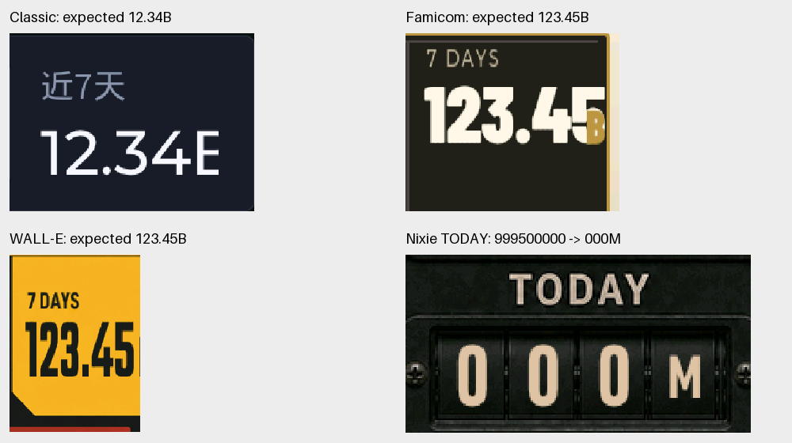

# 今日与 7 天用量显示修复及真机验证

设备：CodexMeter-646355（`codexmeter-646355858428`），480×480，USB `/dev/cu.usbmodem111301`。问题基线为 `2cdf2e8`，本次在保留原主题字体、数字高度、配色和背景的前提下修复以下四处问题。

| 位置 | 原问题 | 修复 |
| --- | --- | --- |
| 共用格式化 / 辉光管 TODAY | `999,500,000` 舍入成 `1000M`，三个数字滚轮截掉高位，显示 `000M` | 从原始整数值舍入；进位后提升单位，今日显示 `1B`。`99.95M` 舍入为 `100M` 时也使用原整数滚轮。删除超长时从左截断的逻辑，异常输入显示 `--`。 |
| Classic 近 7 天 | `12.34B` 裁残单位；`123.45B`、`999.99B` 裁掉单位或末尾数字 | 按每列实际宽度缩放完整数值，仅超宽时调整横向比例。 |
| Famicom 7 DAYS | 单位位置被硬性限制，`B` 与末位数字重叠 | 先预留单位和间隔，再适配数字宽度，单位始终排在数字后。 |
| WALL-E 原版 7 DAYS | 长数字把单位挤出屏幕 | 按右侧区域剩余宽度适配数字，并保留单位和间隔。 |

共用格式化保持原有精度：今日通常一位小数或整数，7 天在 B 及以上保留两位小数。进位和精度切换均从原始值重新计算，避免二次舍入；使用商和余数避免加舍入偏移导致溢出。P/E 单位覆盖 uint64 上限，保证今日最多三个数字。辉光管 7 天仍沿用此前的三位有效数字与独立小数滚轮。

修复前的实机问题：



## 真机验证

刷入固件后检查全部 11 个主题，共 **47 个场景**。截图由设备实际 RGB565 帧缓冲导出，仅旋转到正向并拼接；没有重绘数字。每组图从左到右排列，顶部列出原始输入。完整输入及截图位置见 [cases.json](verification/token-display-fix-2026-10-22/cases.json)。

三组全主题公共场景：

| 场景 | 今日原始值 | 7 天原始值 | 共用显示文本 |
| --- | ---: | ---: | --- |
| normal | 96,200,000 | 1,030,000,000 | `96.2M` / `1.03B` |
| long | 12,340,000,000 | 123,450,000,000 | `12.3B` / `123.45B` |
| rollover | 999,500,000 | 999,990,000,000 | `1B` / `999.99B` |

辉光管 7 天按三位有效数字显示，对应 `1.03B`、`123B`、`1.00T`；小数点在独立窄滚轮中。Cyberpunk、Famicom 今日的前导零继续沿用原设计。

| 主题 | 常规、长数值、进位 | 额外验证 |
| --- | --- | --- |
| Classic | [截图](verification/token-display-fix-2026-10-22/classic-0.png) | [12.34B、100% 配额、切回正常用量](verification/token-display-fix-2026-10-22/classic-1.png) |
| Famicom | [截图](verification/token-display-fix-2026-10-22/famicom-0.png) | [12.34B、100% 配额、切回正常用量](verification/token-display-fix-2026-10-22/famicom-1.png) |
| WALL-E 原版 | [截图](verification/token-display-fix-2026-10-22/walle-0.png) | [12.34B、100% 配额、切回正常用量](verification/token-display-fix-2026-10-22/walle-1.png) |
| 辉光管 | [截图](verification/token-display-fix-2026-10-22/nixie-0.png) | [进位边界](verification/token-display-fix-2026-10-22/nixie-1.png)、[0 与恢复小数](verification/token-display-fix-2026-10-22/nixie-2.png) |
| Cyberpunk | [截图](verification/token-display-fix-2026-10-22/cyberpunk-0.png) | — |
| Animal Crossing | [截图](verification/token-display-fix-2026-10-22/animal_crossing-0.png) | — |
| Gundam | [截图](verification/token-display-fix-2026-10-22/gundam-0.png) | — |
| Gargantua | [截图](verification/token-display-fix-2026-10-22/gargantua-0.png) | — |
| Three Body | [截图](verification/token-display-fix-2026-10-22/three_body-0.png) | — |
| WALL-E EARTH | [截图](verification/token-display-fix-2026-10-22/walle_v10-0.png) | — |
| WALL-E BLUEPRINT | [截图](verification/token-display-fix-2026-10-22/walle_blueprint-0.png) | — |

辉光管边界补测：

- 今日 `999,499,999` → `999M`；`999,500,000` → `1B`。
- 今日 `99,950,000` → `100M`，使用三格整数滚轮；`99,950,000,000` → `100B`。
- 7 天 `9,994,999,999` → `9.99B`；`9,995,000,000` → `10.0B`；`99,950,000,000` → `100B`，验证小数滚轮位置切换及整数布局恢复。
- `0` 和 `96.2M` / `1.03B` 来回切换，数字、小数点、单位均完整。

47 个场景中的数字、小数点及单位均已逐图核对，没有截断或重叠；短值恢复后不遗留压缩比例。Gargantua 最长数值的单位仍落在原背景明亮处，对比度偏低，但字符完整，本次未更改其配色或背景。验证范围为该设备及现有字体资源，不包含字体资源缺失的回退渲染。

## 自动验证

- `tests/test_compact_tokens.cpp`：26 个明确预期用例、单位/精度阈值前后及 100,000 组 uint64 样本，保证今日最多三个数字，小数点在末位数字之前；覆盖无数据、0 和 uint64 最大值。
- `tests/test_nixie_counter.cpp`：原有 34 个滚轮格式化用例通过。
- 实际 `dashboard_view_model.cpp` 宿主编译运行，确认今日/7 天字段接入新的格式化逻辑。
- PlatformIO `waveshare_amoled_216` 固件构建通过，刷写真机成功。

```sh
c++ -std=c++11 tests/test_compact_tokens.cpp -o /tmp/test_compact_tokens && /tmp/test_compact_tokens
c++ -std=c++11 tests/test_nixie_counter.cpp -o /tmp/test_nixie_counter && /tmp/test_nixie_counter
PLATFORMIO_CORE_DIR="$PWD/.platformio" UV_CACHE_DIR="$PWD/.platformio/.cache/uv" \
  .venv/bin/pio run -d firmware -e waveshare_amoled_216
```

本机宿主 C++ 编译额外指定了 Xcode 26 SDK（`-isysroot /Applications/Xcode-26.0.0.app/Contents/Developer/Platforms/MacOSX.platform/Developer/SDKs/MacOSX.sdk`），以避开本机 Command Line Tools 与 Xcode SDK 不匹配。

验证结束后恢复 `theme=nixie`、`preferred=nixie`，自动轮换开启、间隔 5 分钟、亮度 50%、音量 30%。设备日志确认已重新收到真实 BLE 用量（今日 `259,596,712`，7 天 `1,070,912,331`），不再保留注入的测试数据。
